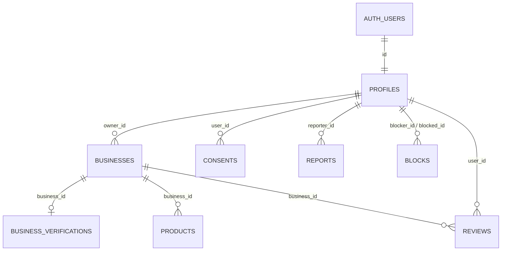
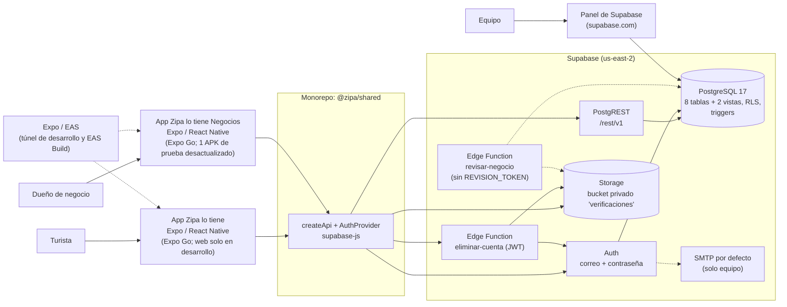

# INFORME DE AUDITORÍA TÉCNICA Y ARQUITECTURA ACTUAL — ZIPA EMPRENDE

**Fecha de corte:** 16 de noviembre de 2026
**Repositorio:** `github.com/luaolayare/zipa_Code` (rama `main`, último commit `0aaa651`), copia local en `C:\app_busqueda`
**Método:** inspección directa de archivos, configuración y dependencias, más consultas **de solo lectura** al proyecto de Supabase desplegado (estado de migraciones, funciones, nombres de secretos y conteo de filas). No se modificó código, no se instalaron paquetes y no se ejecutaron migraciones para este informe.
**Convenciones:** ✅ Implementado · 🟡 Parcial · ❌ Pendiente · ❔ No verificable

> **Nota de nombre.** El encargo habla de "Zipa Emprende". En el código y en las tiendas la marca es **"Zipa lo tiene"** (clientes) y **"Zipa lo tiene Negocios"** (negocios), definida en `packages/shared/src/brand.ts`. Los identificadores internos todavía dicen "vitrina" (nombre anterior: "Vitrina Local"). No hay ninguna referencia a "Zipa Emprende" en el repositorio.

---

## 1. Información general del proyecto

| Aspecto | Estado verificado |
| --- | --- |
| Objetivo | Directorio de restaurantes y emprendimientos locales de **Zipaquirá** para turistas: búsqueda por nombre, categorías, destacados, productos en 3D (pendiente) y reseñas. |
| Forma del producto | **Dos apps móviles** (iOS y Android) en un monorepo: `apps/clientes` (turistas) y `apps/negocios` (dueños). Sin app web pública ni panel administrativo construido. |
| Estado general | **MVP funcional en desarrollo.** Flujo principal operativo contra un backend real (Supabase): registro, publicación (por base de datos), exploración, reseñas, moderación y eliminación de cuenta. Sin pruebas automatizadas, sin CI/CD, sin builds de producción vigentes. |
| Lenguajes | TypeScript (apps y paquete compartido), SQL (PostgreSQL, migraciones), TypeScript/Deno (Edge Functions). |
| Frameworks | Expo SDK **58.0.23**, React Native **0.88.1**, React **19.3.0**, Expo Router **58.0.30**, react-native-web **0.21.4**, `@supabase/supabase-js` **2.119.0**, TypeScript **6.0.3**. |
| Gestor de paquetes | **npm 11.16.0** con *workspaces* (`apps/*`, `packages/*`). Node 24.18.0 en el equipo de desarrollo. |
| Navegación | **Expo Router** (rutas por archivo en `src/app`), pila (`Stack`) y pestañas (`expo-router/js-tabs` con barra personalizada). |
| Plataformas | Android e iOS vía **Expo Go** (verificado en iPhone por túnel). Web solo como vista de desarrollo (`expo start --web`). APK de Android generado una vez (desactualizado). |

**Funcionalidades existentes y pendientes:** ver la tabla detallada en la sección 9.

---

## 2. Estructura del repositorio

**Tipo:** monorepo único con npm workspaces (2 apps + 1 paquete compartido + carpeta de Supabase).

```
zipa_Code/
├── package.json                 # workspaces, scripts (clientes, negocios, :tunel, :web, typecheck), overrides react/react-dom 19.3.0
├── package-lock.json
├── CLAUDE.md, AGENTS.md         # reglas del proyecto y de Expo para asistentes de IA
├── README.md
├── apps/
│   ├── clientes/                # App "Zipa lo tiene" (turistas)
│   │   ├── app.json, eas.json, .env.example, tsconfig.json
│   │   └── src/
│   │       ├── app/             # RUTAS (Expo Router)
│   │       │   ├── _layout.tsx          # carga fuentes, splash, AuthProvider, Stack
│   │       │   ├── index.tsx            # Bienvenida
│   │       │   ├── login.tsx            # entrar / crear cuenta (+ casilla legal)
│   │       │   ├── (tabs)/_layout.tsx   # pestañas con TabBar propia
│   │       │   ├── (tabs)/explorar.tsx  # búsqueda, categorías, destacados, carrusel, lista
│   │       │   ├── (tabs)/perfil.tsx    # sesión, legal, eliminar cuenta
│   │       │   ├── negocio/[id].tsx     # detalle, productos, reseñas, reportar/bloquear
│   │       │   ├── producto/[id].tsx    # marcador del visor 3D (sin implementar)
│   │       │   ├── calificar/[id].tsx   # publicar reseña
│   │       │   ├── reportar.tsx         # reportar reseña/negocio
│   │       │   └── legal/{privacidad,terminos}.tsx
│   │       ├── components/      # BusinessRow, CarouselCard, RankCard, Cover, Rating, Pill, TabBar
│   │       └── lib/             # supabase.ts (cliente), negocios.ts (deep link a la otra app)
│   └── negocios/                # App "Zipa lo tiene Negocios"
│       ├── app.json, eas.json, .env.example
│       └── src/
│           ├── app/
│           │   ├── _layout.tsx, index.tsx, panel.tsx
│           │   ├── registro/{cuenta,datos,verificacion,productos,vista-previa}.tsx  # 5 pasos
│           │   └── legal/{privacidad,terminos}.tsx
│           ├── components/      # RegistroContext (estado del borrador), StepHeader, OptionChips
│           └── lib/supabase.ts
├── packages/shared/             # @zipa/shared — código común (sin compilar, se consume como fuente TS)
│   └── src/
│       ├── api.ts               # capa de datos (createApi): Supabase o datos demo
│       ├── auth.tsx             # AuthProvider/useAuth (sesión), traducción de errores
│       ├── supabase.ts          # fábrica del cliente (AsyncStorage para la sesión)
│       ├── types.ts, categories.ts, brand.ts, theme.ts, moderation.ts, demo.ts
│       ├── legal/               # política de privacidad y términos (borradores con versión/fecha)
│       └── ui/                  # Button, Card, Screen, TextField, ConsentCheckbox, LegalDocumentView,
│                                # ReportView, DeleteAccountButton, CheckEmailView, MissingConfigView, confirm
├── supabase/                    # BACKEND (Supabase gestionado)
│   ├── config.toml              # configuración de la CLI y de Auth (enlazado al proyecto remoto)
│   ├── migrations/0001…0006.sql # esquema, RLS, vistas, triggers, Storage
│   └── functions/
│       ├── eliminar-cuenta/index.ts   # Edge Function (Deno)
│       └── revisar-negocio/index.ts   # Edge Function (Deno)
└── docs/diseno/                 # ESPECIFICACION.md + prototipos HTML (referencia visual, no se ejecutan)
```

| Categoría pedida | Dónde está | Observación |
| --- | --- | --- |
| Frontend | `apps/clientes`, `apps/negocios`, `packages/shared/src/ui` | |
| Backend | `supabase/` (migraciones SQL + 2 Edge Functions) | No hay servidor propio. |
| Pantallas / rutas | `apps/*/src/app` | Expo Router basado en archivos. |
| Componentes | `apps/*/src/components`, `packages/shared/src/ui` | |
| Servicios / API | `packages/shared/src/api.ts` | Único punto de acceso a datos. |
| Hooks | `useAuth`, `useRegistro` | No hay carpeta `hooks/`. |
| Estado / contextos | `AuthProvider` (shared), `RegistroProvider` (negocios) | Sin Redux/Zustand/React Query. |
| Modelos | `packages/shared/src/types.ts` | Tipos escritos a mano (no generados desde la base). |
| Configuración | `app.json`, `eas.json`, `tsconfig.json`, `supabase/config.toml` | |
| Assets | `apps/*/assets` (íconos, splash) | Sin imágenes de contenido. |
| Pruebas | **No existen** | Ningún archivo `*.test.*`. |
| Infraestructura | `supabase/` | Sin Docker, sin CI, sin IaC. |

**Archivos ajenos al código en la raíz:** `zipa_Code.zip` y `diseno-vitrina-local.zip` (excluidos de Git localmente).

**Cambios locales sin commit al momento del corte** (aplicados en Supabase pero no versionados):
`packages/shared/src/ui/TextField.tsx` (corrige un campo de texto invisible), `packages/shared/src/moderation.ts` y `supabase/migrations/0006_filtro_plurales.sql` (filtro de plurales; **la 0006 ya está aplicada en la base remota**), `apps/clientes/src/components/{BusinessRow,CarouselCard}.tsx` (ocultar "0 en 3D") y `supabase/config.toml` (Auth alineado con el remoto, confirmación de correo desactivada).

---

## 3. Arquitectura frontend

| Tema | Hallazgo |
| --- | --- |
| Tecnología | **React Native + Expo** (managed / Continuous Native Generation; no existen carpetas `ios/` ni `android/`). **react-native-web** instalado para vista previa en navegador. No hay Next.js. |
| Código compartido | Sí. `@zipa/shared` lo usan ambas apps (datos, sesión, legal, moderación, tema, UI base). El mismo código corre en Android, iOS y web. |
| Navegación | Expo Router: `Stack` en la raíz; en clientes, grupo `(tabs)` con barra inferior propia (Explorar, "¿Tienes negocio?" que abre la otra app por *deep link*, Perfil). Rutas tipadas (`experiments.typedRoutes`). |
| Estado | `useState` local por pantalla; `AuthProvider` (usuario + instancia de API) y `RegistroProvider` (borrador de 5 pasos, **solo en memoria**: se pierde al cerrar la app). Sin caché de servidor ni sincronización. |
| Consumo de API | Directo con `supabase-js` desde `createApi()` (PostgREST + Storage + Functions). Sin capa HTTP propia, sin reintentos ni caché. |
| Sesión / auth | Supabase Auth con correo y contraseña; sesión persistida en `AsyncStorage`; `onAuthStateChange`. Errores traducidos al español (`authErrorMessage`). Sin Google/Apple. |
| Modo demo | Si faltan las variables de Supabase: datos de ejemplo **solo con `__DEV__`**; en producción `MissingConfigView` ("No pudimos conectarnos") y `createApi` lanza error. Verificado con `expo start --no-dev`. |
| Imágenes / archivos | Solo la foto de verificación (`expo-image-picker`) subida a Storage privado. Negocios y productos **no tienen fotos**: portadas de color por negocio/categoría (`businessCover`). |
| Componentes reutilizables | En shared: `Button`, `Card`, `Screen`, `TextField`, `ConsentCheckbox`, `LegalDocumentView`, `ReportView`, `DeleteAccountButton`, `CheckEmailView`, `MissingConfigView`, `confirmAsync`. En clientes: tarjetas y barra con el diseño del prototipo. |
| Diseño | Clientes: Bienvenida y Explorar replican el prototipo (fuentes Space Grotesk y DM Sans, íconos `lucide-react-native`). Detalle, producto, calificar, login y perfil siguen con el diseño básico. **La app de negocios no está rediseñada** y no carga las fuentes de marca. |
| Diferencias entre plataformas | `confirmAsync` usa `window.confirm` en web y `Alert` en celular. Rutas cargadas por partes en web (`asyncRoutes.web` en negocios). En web, el atributo `aria-checked` de la casilla legal no se refleja (en celular sí). |

**Deuda técnica verificable**
- Tipos de datos escritos a mano en `types.ts` (no generados con `supabase gen types`): pueden desalinearse del esquema.
- `createApi` concentra todo (≈270 líneas) y mezcla demo y producción en cada método.
- La lista de palabras ofensivas está **duplicada** en TypeScript (`moderation.ts`) y SQL (`texto_ofensivo`).
- Las rutas de la pila quedan montadas en web (estilos/estado ocultos); sin impacto en móvil.
- Nombres internos heredados ("vitrina") en slug, scheme, bundle ID y en el nombre de la migración 0002.
- El borrador del registro de negocios no persiste: si la app se cierra, se pierde todo el registro.
- Sin `KeyboardAvoidingView`, sin `returnKeyType`/foco encadenado en formularios.

---

## 4. Expo, Android e iOS

| Aspecto | Clientes | Negocios |
| --- | --- | --- |
| Expo SDK / RN | 58.0.23 / 0.88.1 | 58.0.23 / 0.88.1 |
| Nombre visible | Zipa lo tiene | Zipa lo tiene Negocios |
| slug / scheme | `vitrina-local` / `vitrinalocal` | `vitrina-negocios` / `vitrinanegocios` |
| Bundle ID / package | `co.zipa.vitrinalocal` | `co.zipa.vitrinanegocios` |
| Versión | 0.1.0 | 0.1.0 |
| Plugins | expo-router, expo-font, expo-splash-screen | expo-router, expo-image-picker (micrófono desactivado) |
| Permisos iOS | Cámara (RA), Ubicación en uso | Cámara, Fotos (vía plugin) |
| Permisos Android | CAMERA, ACCESS_COARSE/FINE_LOCATION | CAMERA |
| Proyecto EAS | **No vinculado** (sin `owner` ni `projectId`) | Vinculado (`owner: luisdev1796`, `projectId` presente) |
| `eas.json` | perfiles `preview` (APK interno) y `production` (vacío) | igual |
| EAS Update | **No configurado** (sin `expo-updates`, sin `runtimeVersion`) | igual |
| Builds | Ninguno | 1 APK `preview` (8 nov 2026), **anterior** a la conexión con Supabase y a las Tareas 1–3: está desactualizado |
| iOS | Sin builds; sin cuenta de Apple Developer verificada | igual |

**Observaciones**
- Los permisos de **cámara y ubicación de la app de clientes están declarados, pero el código no usa cámara ni ubicación** (la RA y la geolocalización no existen). Apple puede objetar permisos sin uso.
- **Las variables `EXPO_PUBLIC_SUPABASE_*` solo están en archivos `.env` ignorados por Git.** EAS Build sube el proyecto según `.gitignore`, así que un build en la nube **no las tendría** y mostraría el error de configuración. Hay que declararlas como variables de entorno de EAS.
- `appVersionSource: remote` (EAS gestiona `versionCode`/`buildNumber`).

**Qué funciona hoy en Expo Go (verificado):** ambas apps completas por túnel (`npm run clientes:tunel`, `npm run negocios:tunel`), con recarga en vivo, conectadas al Supabase real, incluida la foto de verificación (`expo-image-picker` viene en Expo Go). Todas las dependencias nativas actuales están incluidas en Expo Go; **todavía no se necesita un development build**.

**Cuándo hará falta un development build:** al agregar la RA/visor 3D nativo, inicio con Apple/Google nativo o cualquier módulo nativo que no esté en Expo Go.

**Qué falta para producción (ambas plataformas):** variables de entorno en EAS, vincular la app de clientes a EAS, perfiles de `production` con `autoIncrement`/canales, EAS Update opcional, íconos y splash definitivos, decidir bundle IDs definitivos (hoy dicen "vitrina"), cuentas de tienda, fichas de tienda y etiquetas de privacidad.

---

## 5. Aplicación web

| Pregunta | Respuesta |
| --- | --- |
| ¿Existe web funcional? | 🟡 Solo como **vista previa de desarrollo** de las apps móviles (`npm run clientes:web` / `negocios:web`). No es un producto web. |
| ¿Cómo se ejecuta? | `expo start --web` (Metro + react-native-web) en `localhost`. |
| ¿Comparte componentes? | Sí, es el mismo código móvil. |
| Rutas públicas | Las mismas rutas de la app (por ejemplo `/negocio/<uuid>`), pero sin despliegue. |
| Renderizado | **Del lado del cliente (SPA)**. No hay `web.output: "static"` ni `"server"` configurado. |
| SEO | Prácticamente nulo hoy: sin HTML pre-renderizado, sin metadatos por página, sin `sitemap`, identificadores UUID en la URL. |
| Páginas por emprendimiento | Existe la ruta `negocio/[id]` (cliente), no indexable. |
| Despliegue con dominio | ❌ Pendiente: falta configurar `web.output` (static o server), metadatos (`expo-router/head`), slugs legibles, hosting (EAS Hosting, Vercel, etc.), dominio y HTTPS. |

**Contradicción a resolver:** `CLAUDE.md` define el producto como "dos apps móviles, sin panel web". El usuario decidió (10 nov 2026) un **panel administrativo web privado**, aún no construido. Una web pública con SEO sería una tercera decisión de producto.

---

## 6. Backend y API

**No hay backend propio.** Se usa **Supabase** (BaaS gestionado): PostgreSQL 17 + PostgREST (API REST automática) + Supabase Auth + Supabase Storage + Edge Functions (Deno).

| Aspecto | Hallazgo |
| --- | --- |
| Proyecto | `zipa-lo-tiene`, región **us-east-2** (Ohio, EE. UU.), estado `ACTIVE_HEALTHY`, plan gratuito (organización "Zipa lo tiene"). |
| Autenticación | Correo + contraseña (mínimo 6 caracteres, valor por defecto). **Confirmación de correo desactivada temporalmente** para pruebas. MFA TOTP habilitado en el proyecto, no usado por la app. |
| Autorización | **Row Level Security** en las 8 tablas; vistas con `security_invoker`. **No hay roles de aplicación** (no hay columna `role`): el "administrador" es quien usa el panel de Supabase / la *service key*, o el token `REVISION_TOKEN`. |
| Validación | En la app (correo, contraseña, cédula/NIT, consentimiento, palabras ofensivas) **y** en la base (CHECK, enums, `unique`, trigger de texto ofensivo, formato de cédula/NIT, límites de tamaño y tipo en Storage). |
| Manejo de errores | Mensajes en español en la app; códigos `23505` (duplicado) tratados como éxito en reportes y bloqueos; Edge Functions responden JSON con códigos HTTP. |
| Lógica de negocio en servidor | Triggers: `handle_new_user` (perfil + consentimientos), `revisar_texto_resena` (filtro). Vistas: `businesses_public` (solo publicados + promedio, conteos), `reviews_public` (oculta bloqueados). Edge Functions (abajo). |
| Integraciones externas | Ninguna operativa además de Supabase y Expo. Sentry, el servicio 3D, Google y Apple se **mencionan en la política de privacidad** pero no están integrados. |
| CORS | `eliminar-cuenta`: `Access-Control-Allow-Origin: *` (protegida por JWT). `revisar-negocio`: sin cabeceras CORS (uso servidor a servidor). |
| Variables de entorno (solo nombres) | Apps: `EXPO_PUBLIC_SUPABASE_URL`, `EXPO_PUBLIC_SUPABASE_ANON_KEY`. Edge Functions: `SUPABASE_URL`, `SUPABASE_ANON_KEY`, `SUPABASE_SERVICE_ROLE_KEY` (inyectadas por Supabase) y **`REVISION_TOKEN` (no configurado)**. |

### Inventario de endpoints usados por las apps

| Operación (`createApi` / `useAuth`) | Recurso Supabase | Método | Estado |
| --- | --- | --- | --- |
| `signUp` | `POST /auth/v1/signup` (con `full_name` y `consents` en metadata) | POST | ✅ Probado real |
| `signIn` | `POST /auth/v1/token?grant_type=password` | POST | ✅ Probado real |
| `signOut` | `POST /auth/v1/logout` | POST | ✅ |
| `listBusinesses`, `getBusiness` | `GET /rest/v1/businesses_public` | GET | ✅ Probado real |
| `listProducts` | `GET /rest/v1/products?business_id=…` | GET | ✅ (sin datos: no se pueden crear productos) |
| `listReviews` | `GET /rest/v1/reviews_public` | GET | ✅ Probado real |
| `createReview` | `POST /rest/v1/reviews` | POST | ✅ Probado real (filtro en app y base) |
| `report` | `POST /rest/v1/reports` | POST | ✅ Probado real |
| `blockUser` / `unblockUser` | `POST` / `DELETE /rest/v1/blocks` | POST/DELETE | 🟡 Probado en demo; `unblockUser` sin interfaz |
| `recordConsents`, `hasAccepted` | `POST` / `GET /rest/v1/consents` | POST/GET | ✅ |
| `myBusiness`, `registerBusiness`, `submitForReview` | `/rest/v1/businesses` | GET/POST/PATCH | ✅ Probado real |
| `saveVerification` | `POST /storage/v1/object/verificaciones/…` + `POST /rest/v1/business_verifications` (upsert) | POST | ✅ Probado real (foto 393 KB subida) |
| `deleteAccount` | `POST /functions/v1/eliminar-cuenta` | POST | ✅ Probado real (borra usuario, datos y foto) |
| — (equipo) | `POST /functions/v1/revisar-negocio` | POST | 🟡 Desplegada; **inoperante sin `REVISION_TOKEN`** (responde 500 "Falta configurar", es decir, falla cerrada) |
| Crear/editar productos, subir videos | — | — | ❌ No implementado |
| Responder reseñas | `PATCH reviews(reply)` permitido por RLS | — | ❌ Sin código en la app |

---

## 7. Base de datos

- **Motor:** PostgreSQL 17 gestionado por Supabase. **Cliente:** `supabase-js` (sin ORM). **Migraciones:** 6 archivos SQL versionados (0001–0006); en la base remota están aplicadas las 6 (la 0006 todavía sin commit en Git).
- **Extensiones activas:** `pgcrypto`, `uuid-ossp`, `pg_stat_statements`, `supabase_vault`, `plpgsql`. **No hay PostGIS.**

### Esquema (resumen)

| Tabla | Columnas clave | Restricciones / relaciones |
| --- | --- | --- |
| `profiles` | `id` (= `auth.users.id`), `full_name` | FK a `auth.users` con cascade; nombre público. |
| `businesses` | `owner_id`, `name`, `type` (enum emprendimiento/establecido), `category` (enum comer/artesanias/cafe_dulces), `address`, `hours`, `whatsapp`, `status` (borrador/en_revision/publicado/rechazado), `specialty`, `price_level` | `name` 2–80, `specialty` ≤40, `price_level` 1–3; índice por `status`. |
| `business_verifications` | `business_id` (PK), `photo_path` (opcional), `id_number`, `reviewed_at`, `photo_deleted_at` | CHECK de formato de cédula/NIT. Solo el dueño la ve. |
| `products` | `business_id`, `name`, `price_cop`, `description`, `video_path`, `model_url`, `status` (procesando/listo/error) | Índice por negocio. **Sin datos ni código para crearlos.** |
| `reviews` | `business_id`, `user_id`, `stars` 1–5, `text`, `reply`, `replied_at` | `unique(business_id, user_id)`; trigger de texto ofensivo; solo se puede actualizar `reply`. |
| `consents` | `user_id`, `document`, `version`, `app`, `accepted_at` (servidor) | Historial; insertar y leer solo lo propio. |
| `reports` | `reporter_id`, `target_type` (review/business/user), `target_id`, `reason`, `details` ≤500, `status` | `unique(reporter, tipo, objetivo)`; índice parcial de pendientes. |
| `blocks` | `blocker_id`, `blocked_id` | PK compuesta; `blocker ≠ blocked`. |

**Vistas:** `businesses_public` (publicados con `rating`, `review_count` y `product_count` calculados por subconsulta) y `reviews_public` (con `author_name`, excluye usuarios bloqueados por quien consulta).

**Storage:** bucket **`verificaciones`** privado (10 MB; jpeg/png/heic/webp) con políticas por carpeta del dueño. Los buckets `productos` y `negocios` se mencionan en `eliminar-cuenta`, pero **no existen**.



**Temas pedidos**
- **Categorías:** enum fijo de 3; "subcategoría" = `specialty` en texto libre. Agregar una categoría exige una migración.
- **Usuarios y roles:** un solo tipo de usuario; sin rol de administrador en la base.
- **Ubicaciones geográficas:** ❌ solo `address` en texto. Sin coordenadas; la distancia (`distanceM`) siempre es `null` con datos reales.
- **Calificaciones:** promedio y conteo calculados al vuelo en la vista (no hay columnas agregadas).
- **Datos actuales en producción:** 8 usuarios (todos de prueba), 14 consentimientos, 0 negocios, 0 reseñas, 0 reportes, 0 archivos.

---

## 8. Infraestructura y cloud

| Componente | Dónde | Estado |
| --- | --- | --- |
| Apps móviles | Expo Go (desarrollo) por túnel `*.on.expo.app` desde el PC del desarrollador | Operativo solo mientras el PC está encendido |
| Builds | EAS Build (cuenta Expo `luisdev1796`) | 1 APK de prueba, desactualizado |
| Frontend web | — | ❌ No desplegado |
| Backend / API | Supabase (us-east-2) | ✅ Desplegado |
| Base de datos | Supabase Postgres 17 | ✅ Desplegada |
| Almacenamiento | Supabase Storage | ✅ Bucket privado |
| Autenticación | Supabase Auth | ✅ (confirmación de correo desactivada) |
| Correo transaccional | SMTP por defecto de Supabase | ⚠️ Solo entrega a miembros del equipo y con límite por hora: no sirve para usuarios reales |
| Edge Functions | Supabase | ✅ 2 activas (`eliminar-cuenta` con JWT, `revisar-negocio` sin JWT y sin token) |
| Código fuente | GitHub `luaolayare/zipa_Code` | ✅ |

| Tema | Estado |
| --- | --- |
| Ambientes | **Uno solo** (el proyecto de Supabase actual hace de desarrollo y de producción). Sin staging. |
| Variables de entorno | `.env` locales por app (ignorados por Git); no hay variables en EAS. |
| CI/CD | ❌ No existe (`.github/` ausente). |
| Docker | ❌ No (las funciones se empaquetaron con `--use-api`). |
| Dominio / HTTPS | Sin dominio propio; HTTPS lo da Supabase (`*.supabase.co`). |
| Logs | Solo los nativos de Supabase (Auth, PostgREST, Functions) ❔ no revisados. Sin Sentry. |
| Monitoreo / alertas | ❌ No. |
| Backups | ❔ Plan gratuito de Supabase: sin PITR; no se verificó la política de respaldos. |
| Escalabilidad | Adecuada para un MVP en el plan gratuito (límites de tamaño, ancho de banda y pausa por inactividad del plan Free). |

---

## 9. Funcionalidades del producto

| Funcionalidad | Estado | Evidencia |
| --- | --- | --- |
| Registro e inicio de sesión | ✅ | `auth.tsx`, `login.tsx`, `registro/cuenta.tsx`; probado contra Supabase. Sin Google/Apple. |
| Aceptación legal (privacidad y términos) | ✅ | `legal/*`, `ConsentCheckbox`, tabla `consents`, trigger. Textos en **borrador** con marcadores `[ ]`. |
| Registro de emprendimientos | 🟡 | 5 pasos; guarda negocio y verificación. **No guarda productos**, ni `specialty`/`price_level`, ni WhatsApp validado. Borrador solo en memoria. |
| Verificación de negocios | 🟡 | Foto privada + cédula/NIT ✅; aprobación por `revisar-negocio` desplegada pero **sin token**; no hay interfaz de revisión. |
| Perfiles comerciales | 🟡 | `negocio/[id].tsx`: datos, calificación, productos, reseñas. Diseño básico (no el del prototipo). |
| Categorías | ✅ | 3 categorías fijas con tiles e íconos. |
| Búsqueda de negocios | ✅ | Por nombre, sin tildes, en el cliente (`normalize`). Sin búsqueda en el servidor. |
| Filtros | 🟡 | Solo por categoría. Sin precio, distancia, horario ni "abierto ahora". |
| Destacados | ✅ | Ranking por calificación con mínimo de 5 reseñas (`MIN_REVIEWS_FOR_RANKING`). No es publicidad pagada. |
| Geolocalización | ❌ | Permiso declarado; sin `expo-location`; sin coordenadas en la base. |
| Mapas | ❌ | Sin librería de mapas. |
| Fotografías | 🟡 | Solo la de verificación (privada). Sin fotos públicas de negocios o productos. |
| Productos y 3D / RA | ❌ | `producto/[id].tsx` es un marcador; paso 4 simulado. |
| Reseñas y calificaciones | ✅ | Crear, listar, promedio, filtro de lenguaje ofensivo (app y base, con plurales). El usuario no puede editar ni borrar su reseña. |
| Responder reseñas (negocio) | ❌ | Permitido por RLS, sin interfaz. |
| Favoritos | ❌ | No existe; **el login lo promete** ("Guarda tus lugares favoritos"). |
| Contacto por WhatsApp | ❌ | El campo se guarda; no hay botón de contacto. |
| Panel de emprendedores | 🟡 | Estado, textos legales, eliminar cuenta. Productos, reseñas y QR son textos fijos. |
| Panel administrativo | ❌ | Decidido como web privada; no construido. Hoy: panel de Supabase. |
| Moderación | 🟡 | Reportar (reseña/negocio) ✅, bloquear ✅, filtro ✅. Sin flujo para revisar y resolver reportes, ni para desbloquear. |
| Eliminación de cuenta | ✅ | `eliminar-cuenta` probada: borra usuario, datos en cascada y archivos. |
| Notificaciones | ❌ | Sin `expo-notifications`; el estado de revisión solo se ve al abrir el panel. |
| Publicidad / negocios destacados pagados | ❌ | No existe. |
| QR para negocios / hoteles | 🟡 | La Bienvenida reconoce `?origen=qr&lugar=…`; no se generan QR. |
| Modo producción sin datos falsos | ✅ | `MissingConfigView` + guardia en `createApi`, probado con `--no-dev`. |

---

## 10. Seguridad y calidad

| # | Severidad | Hallazgo | Recomendación |
| --- | --- | --- | --- |
| S1 | **Alta** | La **contraseña de la base de datos** se compartió por chat durante la configuración y se usó en comandos locales. | Rotarla en Supabase (Settings → Database) y no volver a usarla fuera del gestor de secretos. |
| S2 | **Alta** | **Confirmación de correo desactivada** y SMTP por defecto (no entrega a usuarios reales). | Configurar un SMTP propio (por ejemplo Resend con dominio propio) y reactivar `enable_confirmations` antes de lanzar. |
| S3 | **Alta** | Los builds de EAS no tendrían `EXPO_PUBLIC_SUPABASE_*` (solo en `.env` ignorado). | Declarar las variables en EAS (por entorno). |
| S4 | **Media** | `revisar-negocio` sin `REVISION_TOKEN`: hoy la única forma de publicar es editar la base directamente. | Configurar el secreto o construir el panel admin con un rol de administrador. |
| S5 | **Media** | Contraseña mínima de 6 caracteres sin requisitos de complejidad. | Subir a 8+ y activar la protección contra contraseñas filtradas (si el plan lo permite). |
| S6 | **Media** | Sin roles en la base: la administración depende de la *service key*. | Agregar un rol `admin` (tabla o claim) con políticas RLS específicas para el panel. |
| S7 | **Media** | Permisos de cámara y ubicación declarados en clientes **sin uso**. | Quitarlos hasta implementar RA y geolocalización (riesgo de rechazo en revisión). |
| S8 | **Media** | Lista de palabras ofensivas duplicada (TS y SQL); filtro por palabra exacta (evitable con variantes). | Fuente única (tabla en la base) y moderación humana sobre reportes. |
| S9 | **Media** | 6 vulnerabilidades **moderadas** en dependencias (`npm audit`): `glob`, `minimatch`, `uuid` vía `@expo/cli`, `@expo/fingerprint` y `@expo/ngrok`. Ninguna alta ni crítica; son herramientas de desarrollo, no se incluyen en la app. | Actualizar con el siguiente parche de Expo; no usar `npm audit fix --force`. |
| S10 | **Baja** | `businesses_public` y `reviews_public` exponen `owner_id` y `user_id` (UUID) y `profiles` es legible por todos (solo `full_name`). | Aceptable para el MVP; limitar columnas en las vistas si se quiere minimizar datos. |
| S11 | **Baja** | `eliminar-cuenta` con CORS `*` (protegida por JWT). | Restringir el origen si se publica una web. |
| S12 | **Baja** | 8 usuarios de prueba en la base de producción. | Limpiar y separar ambientes (proyecto de staging). |
| S13 | **Baja** | Textos legales en **borrador** con marcadores (`[NOMBRE DEL RESPONSABLE]`, `[CORREO DE SOPORTE]`, etc.), y la política menciona a Sentry y un servicio 3D no integrados. | Revisión por un abogado; ajustar la lista de encargados a lo realmente usado. |

**Verificado como correcto:** no hay secretos en archivos versionados (búsqueda de claves `sb_secret`, JWT y contraseña en `git ls-files`: sin resultados); RLS activo en las 8 tablas; la foto de verificación **no** es accesible sin sesión, ni por otro usuario, ni por URL pública (probado); otro usuario no puede publicar un negocio ajeno (probado); los consentimientos registran la fecha del servidor; la eliminación de cuenta borra en cascada (probado).

**Calidad**
- **Pruebas automatizadas:** ninguna. Las verificaciones de este ciclo se hicieron con scripts manuales de Playwright y consultas SQL, fuera del repositorio.
- **Tipado:** `npm run typecheck` pasa sin errores en los 3 paquetes.
- **Lint:** no hay ESLint configurado.
- **Rendimiento:** `listBusinesses` trae todos los negocios publicados sin paginación y filtra en el cliente; la vista calcula promedios con subconsultas. Suficiente para decenas de negocios, no para miles.
- **Manejo de errores:** mensajes en español y estados de carga y error en Explorar; varias pantallas (detalle, calificar) no muestran estado de error de red.
- **Accesibilidad:** parcial (roles y etiquetas en lo nuevo; faltan pantallas antiguas, teclado y contraste por revisar). Tarea 4 pendiente.

---

## 11. Diagrama de arquitectura actual

Solo componentes verificados. Las líneas punteadas indican elementos desplegados pero incompletos o inoperantes.



---

## 12. Diagnóstico final

**1. Resumen ejecutivo.** Zipa lo tiene es un monorepo Expo (SDK 58) con dos apps móviles y un paquete compartido, respaldado por Supabase. El núcleo del producto (cuentas, registro y verificación de negocios, exploración, reseñas, moderación básica, cumplimiento legal y eliminación de cuenta) **funciona y está probado contra la base real**. Lo que diferencia al producto (fotos públicas, productos, 3D/RA, mapas y ubicación) **no está implementado**. No hay pruebas automatizadas, CI, ambientes separados ni builds de producción, y el correo transaccional no sirve para usuarios reales.

**2. Tecnologías confirmadas.** Expo SDK 58.0.23, React Native 0.88.1, React 19.3.0, Expo Router 58.0.30, react-native-web 0.21.4, TypeScript 6.0.3, npm workspaces, `@supabase/supabase-js` 2.119.0, `lucide-react-native`, `react-native-svg`, `expo-font` + Google Fonts, `expo-image-picker`; Supabase (Postgres 17, Auth, Storage, Edge Functions en Deno); EAS Build; GitHub.

**3. Componentes funcionales.** Autenticación por correo, consentimiento legal con trazabilidad, registro de negocio con verificación privada, Explorar (búsqueda, categorías, destacados, carrusel), detalle, reseñas con filtro, reportes, bloqueos, eliminación de cuenta, protección contra datos de ejemplo en producción, RLS completo.

**4. Componentes incompletos.** Productos (crear, fotos, video), visor 3D/RA, geolocalización y mapas, WhatsApp, favoritos, panel del negocio (reseñas, respuesta, QR, cifras), panel administrativo, flujo de revisión (token), notificaciones, rediseño de la app de negocios y de 4 pantallas de clientes, inicio con Google/Apple, persistencia del borrador.

**5. Riesgos técnicos.**
- Correo transaccional inservible para usuarios reales (bloquea el registro con confirmación).
- Credencial de la base expuesta en el chat.
- Ambiente único: las pruebas ensucian producción.
- Sin pruebas: cualquier cambio puede romper flujos ya validados.
- El 3D es el diferencial y su viabilidad técnica y su costo no están validados.
- Dependencia de un solo proveedor (Supabase), aceptable para un MVP.

**6. Problemas arquitectónicos.**
- Sin rol de administrador en el modelo de datos.
- Categorías como enum rígido.
- Sin coordenadas geográficas.
- Agregados calculados al vuelo y listado sin paginación.
- Lista de moderación duplicada.
- Tipos manuales en lugar de generados.
- Borrador de registro volátil.
- Nombres internos heredados ("vitrina").
- La regla "sin panel web" de `CLAUDE.md` choca con el panel admin web decidido.

**7. Preparación para producción.** **Baja (≈35–40 %).** La base de datos y la seguridad de datos están en buen nivel para un MVP; faltan el contenido diferencial, la operación (correo, admin, ambientes, monitoreo) y todo el ciclo de publicación.

**8. Qué falta para Android.**
- Variables en EAS.
- Perfil `production` (AAB).
- Cuenta de Google Play (pago único de 25 USD).
- Ficha de la tienda y formulario de **Seguridad de los datos**.
- Cuentas de prueba para el revisor.
- Quitar permisos sin uso.
- Íconos definitivos.
- Prueba cerrada de 14 días con al menos 12 testers. Es requisito de Google Play para cuentas personales nuevas; confirmar las condiciones vigentes en la consola.

**9. Qué falta para iOS.**
- Cuenta de Apple Developer (99 USD al año).
- Vincular la app de clientes a EAS.
- Build con firma (EAS) y distribución por TestFlight.
- **Etiqueta de privacidad** de App Store.
- Revisión de las pautas 1.2 (contenido de usuarios; cumplido en lo básico) y 5.1.1(v) (eliminar cuenta; cumplido).
- **Iniciar sesión con Apple** si se agrega Google.
- Justificar o quitar los permisos sin uso.

**10. Qué falta para web.**
- Decidir si habrá web pública (SEO) además del panel admin.
- Configurar `web.output: "static"` o `"server"`, metadatos por página y slugs legibles.
- Hosting (EAS Hosting o Vercel), dominio y HTTPS.
- Restringir CORS.

**11. Recomendaciones priorizadas.**
1. **Higiene inmediata:**
   - hacer commit de los cambios locales (incluida la migración 0006, ya aplicada en remoto);
   - rotar la contraseña de la base;
   - configurar `REVISION_TOKEN`;
   - borrar los usuarios de prueba.
2. **Operación mínima:**
   - SMTP propio con dominio y reactivar la confirmación de correo;
   - un proyecto de Supabase de *staging*;
   - variables de entorno en EAS;
   - vincular la app de clientes a EAS.
3. **Panel administrativo web** con rol `admin` en la base: aprobar negocios (y borrar la foto), resolver reportes y ver métricas (usuarios, negocios, reseñas).
4. **Completar el ciclo del negocio:**
   - guardar productos con foto (bucket público con políticas);
   - guardar `specialty` y `price_level`;
   - botón de WhatsApp;
   - persistir el borrador;
   - reseñas y respuestas en el panel;
   - QR real.
5. **Ubicación:** coordenadas (`lat`/`lng` o PostGIS) en el registro, `expo-location` para la distancia y, opcionalmente, un mapa.
6. **Calidad:** ESLint, pruebas (unitarias en `@zipa/shared`, E2E con Maestro o Detox), CI en GitHub Actions (typecheck, lint, test) y Sentry.
7. **Diferencial 3D:** prueba técnica de proveedor (video → modelo `.glb`/`.usdz`) y visor; evaluar costo antes de comprometer la promesa en la tienda.
8. **Publicación:** accesibilidad (Tarea 4), `docs/PUBLICACION.md` (Tarea 5), textos legales revisados por un abogado, quitar la promesa de "favoritos" o implementarlos, builds de producción y fichas de tienda.

---

## RESUMEN TÉCNICO PARA COMPARTIR CON CHATGPT

**Producto.** "Zipa lo tiene" (el encargo lo llama "Zipa Emprende"; el código no usa ese nombre): directorio de restaurantes y emprendimientos de Zipaquirá (Colombia) para turistas, con reseñas y, en el futuro, productos en 3D y realidad aumentada. Son **dos apps móviles** del mismo monorepo: `apps/clientes` (turistas) y `apps/negocios` (registro y panel del negocio). No existe app web pública ni panel administrativo; se decidió un panel admin web privado, aún no construido.

**Stack verificado.**
- Monorepo con npm workspaces.
- Expo SDK 58.0.23 en flujo managed, sin carpetas nativas.
- React Native 0.88.1, React 19.3.0 (forzado por `overrides` para evitar copias duplicadas).
- Expo Router 58 (rutas por archivo, pestañas con barra propia, rutas tipadas), TypeScript 6.
- react-native-web solo para vista previa.
- Paquete `@zipa/shared` consumido como fuente: capa de datos `createApi` sobre `supabase-js` 2.119, `AuthProvider` con sesión en AsyncStorage, textos legales versionados, filtro de moderación, tema y componentes base.
- Sin Redux ni React Query: estado local más dos contextos.
- Diseño de clientes parcialmente alineado con un prototipo (Space Grotesk, DM Sans, lucide).

**Backend.**
- Supabase gestionado (proyecto `zipa-lo-tiene`, us-east-2, plan gratuito): Postgres 17, PostgREST, Auth con correo y contraseña, Storage y 2 Edge Functions en Deno. No hay servidor propio ni ORM.
- 6 migraciones SQL (todas aplicadas en remoto; la 0006 sin commit en Git).
- Tablas:
  - `profiles`
  - `businesses`: enums de tipo, categoría (3 fijas) y estado; `specialty` libre; `price_level`; sin coordenadas
  - `business_verifications`: foto privada y cédula/NIT, con fecha de revisión y de borrado de la foto
  - `products`: sin uso aún
  - `reviews`: única por usuario y negocio; solo `reply` editable
  - `consents`: historial de aceptación legal con versión
  - `reports`
  - `blocks`
- Vistas `businesses_public` (solo publicados, con promedio y conteos por subconsulta) y `reviews_public` (oculta bloqueados).
- Triggers: alta de perfil y consentimientos al registrarse, y filtro de texto ofensivo con plurales.
- RLS en todas las tablas, verificado: un tercero no ve fotos ni cédulas y no puede publicar negocios ajenos.
- Bucket privado `verificaciones` con política por carpeta del dueño.
- Edge Functions:
  - `eliminar-cuenta` (con JWT; borra archivos y el usuario de Auth, y el resto en cascada; probada);
  - `revisar-negocio` (publica o rechaza y borra la foto; protegida por `REVISION_TOKEN`, que **no está configurado**).
- No hay rol de administrador en la base.

**Estado funcional (probado de punta a punta contra Supabase).** Registro e inicio de sesión con aceptación legal; registro de negocio en 5 pasos (guarda datos básicos, foto y cédula; **no** guarda productos, `specialty` ni `price_level`); Explorar (búsqueda por nombre en el cliente, 3 categorías, destacados con mínimo de 5 reseñas, carrusel y lista); detalle del negocio; reseñas con filtro en app y base; reportar reseñas y negocios; bloquear usuarios; eliminar cuenta. En producción la app se niega a mostrar datos de ejemplo.

**No implementado.** Productos con fotos o video, visor 3D/RA, geolocalización y mapas, botón de WhatsApp, favoritos (pero el login los promete), responder reseñas, QR, métricas, notificaciones, inicio con Google/Apple, panel administrativo, flujo de resolución de reportes, persistencia del borrador de registro, rediseño de la app de negocios.

**Infraestructura y operación.**
- Un solo ambiente (Supabase hace de desarrollo y de producción), con 8 usuarios de prueba.
- Variables `EXPO_PUBLIC_SUPABASE_URL` y `EXPO_PUBLIC_SUPABASE_ANON_KEY` solo en `.env` locales (no en EAS, así que los builds en la nube fallarían).
- EAS: la app de negocios está vinculada y tiene 1 APK de prueba desactualizado; la de clientes no está vinculada. Sin EAS Update, sin builds de iOS, sin cuentas de tienda verificadas.
- Sin CI/CD, Docker, dominio, monitoreo ni Sentry, y sin pruebas automatizadas ni ESLint. `typecheck` pasa sin errores.
- Desarrollo en Expo Go por túnel desde el PC.

**Seguridad.**
- Alta: contraseña de la base compartida en un chat (rotar); confirmación de correo desactivada y SMTP por defecto inútil para usuarios reales; variables ausentes en EAS.
- Media: sin rol admin; `REVISION_TOKEN` faltante; contraseña mínima de 6 caracteres; permisos de cámara y ubicación declarados sin uso en clientes; lista de moderación duplicada; 6 vulnerabilidades moderadas en herramientas de desarrollo de Expo.
- Bien: sin secretos en Git, RLS completo, Storage privado probado, consentimientos con fecha del servidor, borrado en cascada.

**Preparación para producción.** Baja (≈35–40 %).

**Próximo ciclo sugerido:**
1. Higiene: commit, rotar la contraseña, token de revisión, limpiar usuarios de prueba.
2. SMTP propio, staging y variables en EAS.
3. Panel admin web con rol `admin`.
4. Productos y fotos públicas, WhatsApp, coordenadas y ubicación.
5. Pruebas, CI y Sentry.
6. Prueba técnica del 3D.
7. Accesibilidad, revisión legal, builds y fichas de tienda (Android: cuenta Play, AAB, formulario de Seguridad de los datos, prueba cerrada; iOS: Apple Developer, TestFlight, etiqueta de privacidad, Sign in with Apple si hay Google).
