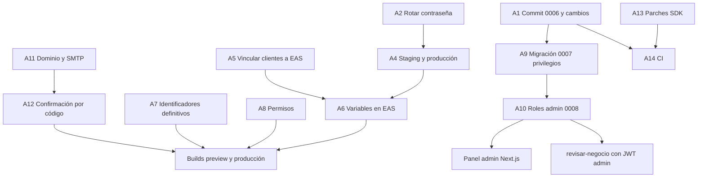

# Zipa lo tiene — Plan de la Fase 1: estabilización de infraestructura

**Fecha:** 16 de noviembre de 2026 · Requiere autorización por paso (sección 8).

**Estado de ejecución:**
- **Paso 1 (higiene): hecho** — commits `58c144a` y `e89345f`.
- **Paso 2 (permisos y parches del SDK 58): hecho** — commit `c9251f4`.
- **Paso 3 (ESLint, pruebas, Node): hecho** — commit `dd3ba83`.
- **Paso 4 (CI con GitHub Actions): hecho** — commits `a0e5a29`, `df4e17a`, `883a933` y `311ad64`, llevados a `main` por *fast-forward*. Tres ejecuciones en verde en GitHub.
- Los demás pasos: pendientes de autorización.

> **Riesgo abierto (decisión del responsable, 16 nov 2026):** la contraseña de PostgreSQL que se compartió por chat **todavía no se rota**. Debe rotarse antes de crear el proyecto de producción (Paso 9) y antes de dar acceso a terceros.

**Arquitectura acordada:**
- monorepo con dos apps Expo (`apps/clientes`, `apps/negocios`) y `packages/shared`;
- Supabase como único backend;
- un futuro panel administrativo privado en **Next.js** (`apps/admin`).

**Fuera de alcance:** web pública, Spring Boot, microservicios y AWS.

**Método de esta revisión:** solo lectura. Inspeccioné el repositorio, consulté Supabase con `SELECT` y la CLI (`migration list`, `functions list`, `secrets list` solo nombres) y revisé EAS (`whoami`, `env:list`, `build:list`). También corrí `expo install --check`, `expo-doctor` y `expo config --type introspect`. No modifiqué código, datos, secretos ni proyectos remotos. El único archivo nuevo es este.

---

## 1. Diagnóstico actualizado

### 1.1 Git y migraciones

| Elemento | Estado |
| --- | --- |
| Rama / remoto | `main`, sincronizada con `origin/main` hasta `0aaa651`. |
| Cambios sin commit | `packages/shared/src/ui/TextField.tsx` (campo multilínea invisible, corregido), `packages/shared/src/moderation.ts` (plurales en el filtro), `apps/clientes/src/components/{BusinessRow,CarouselCard}.tsx` (ocultar "0 en 3D"), `supabase/config.toml` (Auth alineado con el remoto, `enable_confirmations = false`). |
| Archivos sin seguimiento | `supabase/migrations/0006_filtro_plurales.sql`, `AUDITORIA_ARQUITECTURA_ZIPA_EMPRENDE.md`, este plan. |
| Migraciones locales | 0001 → 0006. |
| Migraciones remotas (`supabase_migrations.schema_migrations`) | 0001 → 0006. **La 0006 está aplicada en remoto pero no está en Git.** |
| Deriva de esquema | No encontré diferencias con lo que definen las migraciones: 8 tablas, 2 vistas, 18 políticas en `public` y 3 en `storage.objects`, 3 funciones (`handle_new_user` con *security definer*, `texto_ofensivo`, `revisar_texto_resena`), 2 triggers propios. No hay objetos creados a mano desde el panel. *(`supabase db diff` requiere Docker; la comparación se hizo consultando el catálogo.)* |
| Privilegios | Por la opción "Automatically expose new tables", `anon` y `authenticated` tienen **todos** los privilegios de tabla (incluidos `TRUNCATE`, `TRIGGER` y `REFERENCES`) sobre las 8 tablas y las vistas. RLS limita filas en `SELECT/INSERT/UPDATE/DELETE`, y PostgREST no expone `TRUNCATE`, así que **no es explotable hoy**. Aun así, contradice el principio de mínimo privilegio, y cualquier tabla nueva quedará expuesta automáticamente. |
| Datos | 8 usuarios (todos de prueba, todos confirmados), 14 consentimientos, 0 negocios, 0 reseñas, 0 reportes, 0 archivos. |
| Secretos de Functions | Solo los automáticos de Supabase. **Falta `REVISION_TOKEN`** (la función `revisar-negocio` falla cerrada). |

### 1.2 Expo y EAS

| Aspecto | Clientes | Negocios |
| --- | --- | --- |
| Nombre visible | Zipa lo tiene | Zipa lo tiene Negocios |
| `slug` / `scheme` | `vitrina-local` / `vitrinalocal` | `vitrina-negocios` / `vitrinanegocios` |
| iOS `bundleIdentifier` / Android `package` | `co.zipa.vitrinalocal` | `co.zipa.vitrinanegocios` |
| Proyecto EAS | **No vinculado** (sin `owner` ni `extra.eas.projectId`) | Vinculado: `owner: luisdev1796`, `projectId 3c87b418-…` |
| Perfiles `eas.json` | `preview` (APK interno), `production` vacío | igual |
| Perfil `development` | No existe | No existe |
| `environment` por perfil | No definido | No definido |
| Variables en EAS (`production`) | — | **Ninguna** (`eas env:list`) |
| Variables locales | `.env` (ignorado por Git) con `EXPO_PUBLIC_SUPABASE_URL` y `EXPO_PUBLIC_SUPABASE_ANON_KEY` | igual |
| `expo-updates` / `runtimeVersion` / canales | No | No |
| Builds | Ninguno | 1 build Android `preview` (9 nov 2026, commit `e7f1b59`): **anterior** a Supabase y a las Tareas 1–3 |

**Consecuencia:** un build en EAS sube el proyecto según `.gitignore`, sin los `.env`. Ese build arrancaría con `MissingConfigView` ("No pudimos conectarnos").

### 1.3 Autenticación (remota)

| Ajuste | Valor actual | Observación |
| --- | --- | --- |
| Proveedor | Correo y contraseña | Sin Google/Apple. |
| `enable_confirmations` | **false** (temporal, para pruebas) | Debe volver a `true`. |
| SMTP | El incluido por Supabase | Solo entrega a miembros del equipo, con límite de pocos correos por hora. No sirve para usuarios reales. |
| `minimum_password_length` | 6 | Bajo. |
| `site_url` / `additional_redirect_urls` | `http://localhost:3000` / vacío | Los enlaces de correo no apuntarían a ninguna app. |
| MFA TOTP | Habilitado en el proyecto | Ninguna app lo usa; útil para administradores. |
| Plantillas de correo | Por defecto, en inglés | |

### 1.4 Permisos declarados frente a funciones implementadas

Permisos finales calculados con `npx expo config --type introspect`:

| App | Permiso | ¿Lo usa el código? | Acción propuesta |
| --- | --- | --- | --- |
| Clientes | `CAMERA` / `NSCameraUsageDescription` | **No** (la RA no existe) | Quitar hasta implementar la RA. ✅ Hecho (Paso 2). |
| Clientes | `ACCESS_FINE/COARSE_LOCATION` / `NSLocationWhenInUseUsageDescription` | **No** (sin `expo-location`) | Quitar hasta implementar la distancia. ✅ Hecho (Paso 2). |
| Clientes | `READ_EXTERNAL_STORAGE`, `WRITE_EXTERNAL_STORAGE` | No | Bloquear con `android.blockedPermissions`. ✅ Hecho (Paso 2). |
| Negocios | `READ_EXTERNAL_STORAGE`, `WRITE_EXTERNAL_STORAGE` | Los añade `expo-image-picker` en su manifiesto. La documentación del SDK 58 dice que abrir la galería no requiere permiso en Android, pero **no garantiza** que bloquearlos sea seguro. | **Se mantienen** hasta probar cámara y galería en un Android real con un build `preview` (Paso 7). Si funcionan sin ellos, se bloquean. |
| Ambas | `SYSTEM_ALERT_WINDOW` | No (añadido por defecto) | Bloquear. ✅ Hecho (Paso 2). |
| Ambas | `VIBRATE`, `INTERNET` | `INTERNET` sí; `VIBRATE` es inofensivo | Mantener. |
| Negocios | `CAMERA` / `NSCameraUsageDescription` | **Sí** (foto del local) | Mantener. |
| Negocios | `NSPhotoLibraryUsageDescription` | **Sí** (elegir foto) | Mantener. |
| Negocios | `RECORD_AUDIO` | No | Ya está bloqueado por el plugin (`microphonePermission: false`). ✅ |

### 1.5 Dependencias

| Hallazgo | Detalle |
| --- | --- |
| SDK | Expo 58 con React Native 0.88.1 y React 19.3.0 (fijado con `overrides` junto con `react-dom`). |
| Parches disponibles (mismo SDK) | `expo` 58.0.23 → ~58.0.25 · `expo-router` 58.0.30 → ~58.0.31 · `expo-constants` → ~58.0.16 · `expo-linking` → ~58.0.17 · `expo-status-bar` → ~58.0.5 · *(clientes)* `expo-font` → ~58.0.12 · `expo-splash-screen` → ~58.0.14. **Riesgo bajo** (parches del mismo SDK). |
| `expo-doctor` | Solo falla por lo anterior; antes pasaba 20/20 y no hay React duplicado. |
| `npm audit` | Después del Paso 2: **5 moderadas**, ninguna alta ni crítica (antes 6). Con `--omit=dev` quedan 3 (`expo`, `@expo/fingerprint`, `minimatch`): son dependencias del paquete `expo`, pero corresponden a herramientas que corren en el PC al compilar (huella del build, búsqueda de archivos), no a código que viaje dentro de la app. *(Corrige la afirmación anterior "ninguna llega a las apps": sí están en el árbol de producción de npm, aunque no en el paquete JavaScript del celular.)* No usar `audit fix --force`, porque cambiaría versiones del SDK. |
| Rangos | `@supabase/supabase-js ^2.119`, `lucide-react-native ^1.70` y `react-native-web ^0.21.4` usan `^`. El `package-lock.json` los fija, y `npm ci` en CI respeta el lock. |
| Runtime | Node 24.18 local. ✅ Paso 3: `.nvmrc` (22) y `engines` (`>=22.13`, mínimo del SDK 58). |
| Calidad | ✅ Paso 3: ESLint (`eslint-config-expo` ~58.0.4) en las 3 partes y 38 pruebas con `jest-expo` ~58.0.14 / Jest 30 en `@zipa/shared`. |
| Panel Next.js (futuro) | Comparte `node_modules` del monorepo. Next.js necesita `react` y `react-dom` iguales, y el `override` 19.3.0 los alinea. Hay que verificar que la versión de Next.js elegida acepte React 19.3 y TypeScript 6 antes de instalarla. No debe importar `@zipa/shared/ui` (React Native), solo módulos puros (tipos, `brand`, `legal`, `moderation`). |

---

## 2. Acciones ordenadas por prioridad

| P | Acción | Por qué | Toca |
| --- | --- | --- | --- |
| **P0** | Commit de los cambios locales y de la migración 0006 | Git debe coincidir con la base remota | Solo Git |
| **P0** | **Rotar la contraseña de la base** (la haces tú en el panel) | Se compartió por chat | Supabase (manual) |
| **P0** | Configurar `REVISION_TOKEN` (lo haces tú; te doy el comando) | La revisión de negocios no funciona | Secreto remoto |
| **P1** | Separar *staging* y *producción* (sección 3) | Las pruebas no deben vivir en producción | Supabase y EAS |
| **P1** | Variables de entorno en EAS por ambiente y perfiles con `environment` | Los builds no se conectarían | `eas.json` y EAS |
| **P1** | Vincular la app de clientes a EAS | No se puede compilar | `apps/clientes/app.json` |
| **P1** | Migración 0007 de **mínimo privilegio** (sección 4) | Evitar la exposición automática de tablas | SQL |
| **P1** | Ajustar permisos (sección 1.4) | Rechazos en tiendas | `app.json` ×2 |
| **P2** | SMTP transaccional y verificación por **código de 6 dígitos** (sección 3.3) | Usuarios reales sin enlaces rotos | Supabase Auth y `auth.tsx` |
| **P2** | Roles administrativos (migración 0008, sección 4) | Base del panel Next.js | SQL y Edge Function |
| **P2** | Parches del SDK 58 | Compatibilidad | `package.json` ×2 y lock |
| **P2** | CI con GitHub Actions: typecheck, lint y pruebas (sección 5) | Evitar regresiones | `.github/`, configs |
| **P3** | Decidir identificadores definitivos antes del primer envío a tiendas | Después de publicar ya no se pueden cambiar | `app.json` ×2, EAS |
| **P3** | Unificar la lista de moderación en una tabla | Hoy está duplicada en TS y SQL | SQL y `moderation.ts` |

---

## 3. Diseño de ambientes, autenticación y correo

### 3.1 Staging y producción en Supabase

**Propuesta:** dos proyectos independientes en la misma organización.

| Ambiente | Proyecto | Uso |
| --- | --- | --- |
| Staging | **El actual** `zipa-lo-tiene` (`auilsjqprobmhusvxmmz`, renombrado en el panel a `zipa-lo-tiene-staging`) | Desarrollo, Expo Go, builds `preview`, pruebas. Ya tiene solo datos de prueba. |
| Producción | **Nuevo** `zipa-lo-tiene` (se crea cerca del lanzamiento) | Builds `production` y tiendas. Nace limpio, con contraseña nueva que nunca pase por un chat. |

Por qué así y no al revés: el proyecto actual ya tiene usuarios de prueba y una contraseña expuesta. Convertirlo en staging evita migrar o borrar datos (cumple "no eliminar usuarios"), y producción arranca sin historia.

- **Región de producción:** mantener `us-east-1/2`. Desde Colombia la latencia hacia el este de EE. UU. suele ser similar o menor que hacia São Paulo; se puede medir antes de crear el proyecto.
- **Plan:** producción debería pasar a **Pro**. El plan gratuito pausa por inactividad, no tiene backups diarios garantizados ni PITR y tiene límites bajos.
- **Esquema:** idéntico en ambos, aplicado **solo con migraciones** (nunca con cambios manuales en el panel). Flujo: migración en una PR → CI la aplica en staging → aprobación manual → se aplica en producción.
- **Configuración de Auth:** se versiona en `supabase/config.toml` y se aplica con `supabase config push` a cada proyecto. Lo propio de cada ambiente (`site_url`, SMTP) se maneja con `env(...)` en el TOML.

### 3.2 EAS: perfiles y variables

`eas.json` propuesto (las dos apps):

```json
{
  "cli": { "version": ">= 16.0.0", "appVersionSource": "remote" },
  "build": {
    "development": { "developmentClient": true, "distribution": "internal", "environment": "development" },
    "preview": { "distribution": "internal", "environment": "preview", "android": { "buildType": "apk" } },
    "production": { "environment": "production", "autoIncrement": true }
  },
  "submit": { "production": {} }
}
```

Variables por ambiente, cargadas con `eas env:create`. Solo se guardan **nombres** en el repo; los valores van en EAS:

| Variable | development / preview | production |
| --- | --- | --- |
| `EXPO_PUBLIC_SUPABASE_URL` | URL de staging | URL de producción |
| `EXPO_PUBLIC_SUPABASE_ANON_KEY` | clave publicable de staging | clave publicable de producción |
| `APP_VARIANT` | `staging` | `production` |

Opcional, recomendado: pasar `app.json` a `app.config.ts` para que `APP_VARIANT=staging` agregue el sufijo `.staging` al identificador y al nombre ("Zipa lo tiene (pruebas)"). Así ambas versiones conviven en el mismo celular. **Cambia identificadores**, así que requiere autorización.

`perfil development` solo hará falta cuando se agreguen módulos nativos que no están en Expo Go (RA, Sign in with Apple nativo).

### 3.3 Autenticación y SMTP transaccional

**Proveedor propuesto:** **Resend**. Plan gratuito de 3.000 correos al mes (100 al día), integración documentada con Supabase y verificación de dominio. Alternativas: Amazon SES (más barato a escala, más configuración) o Postmark.

**Requisitos:**
1. **Dominio propio** (por ejemplo `zipalotiene.co`). Hoy no existe.
2. Registros DNS **SPF, DKIM y DMARC** del dominio verificados en Resend.
3. Remitente `no-responder@<dominio>` con nombre "Zipa lo tiene".
4. Un SMTP por ambiente: staging puede usar un subdominio (`staging.<dominio>`).

**Verificación de correo, recomendación:** usar un **código de 6 dígitos (OTP)** en lugar de un enlace.

| Opción | Ventajas | Desventajas |
| --- | --- | --- |
| **Código OTP en la app** (recomendada) | Funciona en Expo Go y en los builds, sin *deep links* ni página web; la persona no sale de la app. | Requiere una pantalla para ingresar el código. |
| Enlace mágico con *deep link* | Un toque desde el correo. | Necesita un `scheme` definitivo, `additional_redirect_urls` y manejo de PKCE; en Expo Go la URL cambia con cada túnel. |

**Cambios de configuración** (en `config.toml`, aplicados con `config push`):

```toml
[auth]
site_url = "zipalotiene://"        # o la URL del panel admin en producción
minimum_password_length = 8
password_requirements = "letters_digits"

[auth.email]
enable_confirmations = true
otp_length = 6                      # código de confirmación de 6 dígitos
otp_expiry = 3600
max_frequency = "1m0s"

[auth.email.smtp]
enabled = true
host = "smtp.resend.com"
port = 465
user = "resend"
pass = "env(SMTP_PASS)"             # el valor nunca va en el repo
admin_email = "no-responder@<dominio>"
sender_name = "Zipa lo tiene"

[auth.email.template.confirmation]
subject = "Tu código de Zipa lo tiene"
content_path = "./supabase/templates/confirmacion.html"   # usa {{ .Token }}
```

**Cambio de código asociado:** en `packages/shared/src/auth.tsx`, la función `verifyEmailCode(email, token)` usará `supabase.auth.verifyOtp({ type: 'signup' })`. `CheckEmailView` pasará a pedir el código y tendrá "Reenviar código" (`auth.resend`).

---

## 4. Seguridad de la base: mínimo privilegio y roles administrativos

### 4.1 Migración 0007: mínimo privilegio

- `revoke all` sobre las tablas y vistas de `public` para `anon` y `authenticated`. Después, `grant` explícito **solo** de lo que las apps usan (tabla de abajo). RLS sigue igual.
- `alter default privileges in schema public revoke all on tables from anon, authenticated;` para que las tablas futuras **no** se expongan solas. En el panel, desactivar "Automatically expose new tables" en ambos proyectos.
- `revoke execute` en funciones internas que no deben llamarse por API (`handle_new_user`, `revisar_texto_resena`).

| Objeto | `anon` | `authenticated` |
| --- | --- | --- |
| `businesses_public`, `reviews_public` | SELECT | SELECT |
| `products` | SELECT | SELECT, INSERT, UPDATE, DELETE (RLS: dueño) |
| `businesses` | — | SELECT, INSERT, UPDATE |
| `business_verifications` | — | SELECT, INSERT, UPDATE |
| `reviews` | — | SELECT, INSERT, UPDATE(`reply`, `replied_at`) |
| `profiles` | SELECT | SELECT, UPDATE(`full_name`) |
| `consents`, `reports` | — | SELECT, INSERT |
| `blocks` | — | SELECT, INSERT, DELETE |

> Verificar con las apps en staging **antes** de aplicarla en producción: si falta un `grant`, la app recibe `permission denied`.

### 4.2 Migración 0008: roles administrativos

**Principio:** el panel Next.js **nunca** usa la *service role key* en el navegador. El administrador entra con su propia cuenta de Supabase; sus permisos salen de una tabla y de políticas RLS, y las operaciones privilegiadas pasan por Edge Functions que validan el rol.

1. Tabla `public.admin_users(user_id uuid pk → auth.users, role text check in ('admin','revisor'), created_at, created_by)`. RLS activo **sin políticas** para `anon` ni `authenticated`: nadie la lee ni la escribe por API. Las altas y bajas se hacen por SQL o desde una Edge Function de superadmin.
2. Función `public.is_admin(min_role text default 'revisor') returns boolean`, con `security definer`, `stable` y `set search_path = ''`. Consulta `admin_users` para `auth.uid()` **y** exige MFA: `(auth.jwt() ->> 'aal') = 'aal2'`.
3. Políticas **adicionales** (no reemplazan las actuales):
   - `businesses`: SELECT de todos los estados para `is_admin()`.
   - `business_verifications`: SELECT para `is_admin()`.
   - `reports`: SELECT y UPDATE(`status`) para `is_admin()`.
   - `reviews`: DELETE para `is_admin('admin')`.
   - `storage.objects` en `verificaciones`: SELECT para `is_admin()` (para ver la foto con una *signed URL* de corta duración).
4. Tabla `public.admin_actions(id, admin_id, action, target_type, target_id, details jsonb, created_at)`: bitácora de cada decisión. Solo insertan las Edge Functions; los administradores la leen.
5. **Edge Function `revisar-negocio`:** pasa de `REVISION_TOKEN` a **JWT del administrador**. Lee el usuario del token, comprueba `is_admin()` con un cliente que lleva su JWT, y solo entonces usa la *service role* (dentro de la función) para cambiar el estado, borrar la foto y escribir en `admin_actions`. `REVISION_TOKEN` queda como respaldo de emergencia o se elimina.
6. **Métricas del panel** (número de usuarios, negocios por estado, reseñas, reportes pendientes): una función `admin_metrics()` con `security definer` que devuelve agregados solo si `is_admin()`. Así el panel no necesita leer `auth.users`.
7. **Panel Next.js** (fase posterior): `@supabase/ssr` con cookies, solo la clave publicable, middleware que exige sesión, y `aal2` antes de mostrar datos. Alojamiento privado (Vercel u otro) con dominio `admin.<dominio>`.

Alternativa descartada por ahora: un *Custom Access Token Hook* que agregue el rol al JWT. Es más rápido en las políticas, pero hay que refrescar sesiones al cambiar roles y es más difícil de auditar. Se puede adoptar más adelante sin cambiar la interfaz `is_admin()`.

### 4.3 Otras migraciones previstas (no urgentes)

| Migración | Contenido |
| --- | --- |
| 0009 `palabras_moderacion` | Tabla `moderation_words` como fuente única; `texto_ofensivo()` la consulta; la app la lee al iniciar (o se valida solo en servidor). |
| 0010 `ubicacion_negocios` | `lat`/`lng` (o PostGIS `geography(Point)`) en `businesses` e índice; fase de producto, no de infraestructura. |

---

## 5. CI con GitHub Actions (implementado en el Paso 4)

**Estado:** ✅ en `.github/workflows/ci.yml`. Respecto al borrador de abajo: corre también en ramas `ci/**` (para probar cambios del propio CI); usa `actions/checkout@v7`, `actions/setup-node@v7` y `supabase/setup-cli@v3` (las versiones anteriores usaban Node 20, obsoleto); aplica las migraciones con `supabase migration up --local`, comprueba que el número de migraciones aplicadas coincida con los archivos y corre `supabase/ci/verificar_esquema.sql` en lugar de pgTAP (pgTAP sigue pendiente). Permisos del workflow: solo lectura. Sin secretos.

*Borrador original, como referencia:*

**Reglas:** usar `npm ci` (respeta el lock, no actualiza nada), sin `audit fix` ni `--fix` automáticos, y Node fijado con `.nvmrc`.

`.github/workflows/ci.yml` (borrador):

```yaml
name: CI
on:
  pull_request:
  push:
    branches: [main]
concurrency: { group: ci-${{ github.ref }}, cancel-in-progress: true }
jobs:
  calidad:
    runs-on: ubuntu-latest
    steps:
      - uses: actions/checkout@v4
      - uses: actions/setup-node@v4
        with: { node-version-file: .nvmrc, cache: npm }
      - run: npm ci
      - run: npm run typecheck
      - run: npm run lint            # nuevo: expo lint en cada app
      - run: npm test                # nuevo: jest-expo en packages/shared
      - name: Compatibilidad con el SDK (informativo)
        run: |
          (cd apps/clientes && npx expo install --check) || echo "::warning::clientes con versiones fuera del SDK"
          (cd apps/negocios && npx expo install --check) || echo "::warning::negocios con versiones fuera del SDK"
  migraciones:
    runs-on: ubuntu-latest
    steps:
      - uses: actions/checkout@v4
      - uses: supabase/setup-cli@v1
      - run: supabase db start       # Postgres local en Docker del runner
      - run: supabase db reset       # aplica 0001…N desde cero: detecta migraciones rotas
      - run: supabase test db        # pruebas pgTAP de RLS (fase 2)
```

**Pasos previos necesarios** (son cambios de código y requieren autorización):

| Paso | Detalle |
| --- | --- |
| ESLint | `npx expo lint` en cada app genera `eslint.config.js` con `eslint-config-expo` en una versión compatible con el SDK 58. Script `lint` en la raíz: `npm run lint --workspaces --if-present`. |
| Pruebas | `jest-expo` (versión del SDK 58) en `packages/shared`. Primeras pruebas: `findOffensiveWords` (incluye plurales y "Che Guevara"), `normalize`, `normalizeIdNumber` e `isValidIdNumber`, `formatRating`, `formatDistance`, `consentsFor` y `authErrorMessage`. |
| Pruebas de RLS (fase 2) | `supabase/tests/*.sql` con pgTAP: un usuario no ve verificaciones ajenas, `anon` no inserta reseñas, no se puede publicar un negocio ajeno, etc. Repite como prueba automática lo que hoy se verificó a mano. |
| Node | ✅ Hecho (Paso 3): `.nvmrc` con `22` y `"engines": { "node": ">=22.13" }` (mínimo oficial del SDK 58 según docs.expo.dev). |
| Despliegue de migraciones (fase 2) | Workflow aparte, manual (`workflow_dispatch`), con *GitHub Environments*: `staging` automático y `production` con aprobación requerida. Secretos de GitHub: `SUPABASE_ACCESS_TOKEN`, `SUPABASE_DB_PASSWORD_STAGING` y `SUPABASE_DB_PASSWORD_PROD`. |

---

## 6. Archivos que requieren modificación

| Archivo | Cambio | Sección |
| --- | --- | --- |
| `supabase/migrations/0006_filtro_plurales.sql` | Solo commit (ya aplicada en remoto) | 1.1 |
| `supabase/migrations/0007_privilegios_minimos.sql` | Nuevo | 4.1 |
| `supabase/migrations/0008_roles_admin.sql` | Nuevo | 4.2 |
| `supabase/config.toml` | Auth: confirmación, OTP, contraseña ≥8, SMTP con `env()`, plantillas | 3.3 |
| `supabase/templates/confirmacion.html` | Nuevo, en español con `{{ .Token }}` | 3.3 |
| `supabase/functions/revisar-negocio/index.ts` | Validar JWT de admin y `is_admin()`; registrar en `admin_actions` | 4.2 |
| `apps/clientes/app.json` | Quitar cámara y ubicación; `android.blockedPermissions`; `owner` y `extra.eas.projectId` al vincular | 1.4, 3.2 |
| `apps/negocios/app.json` | `android.blockedPermissions` (almacenamiento y `SYSTEM_ALERT_WINDOW`) | 1.4 |
| `apps/*/eas.json` | Perfiles `development`/`preview`/`production` con `environment`; `cli.version` | 3.2 |
| `apps/*/app.config.ts` (opcional) | Sustituir `app.json` para variantes staging y producción | 3.2 |
| `apps/*/.env.example` | Documentar `APP_VARIANT` | 3.2 |
| `packages/shared/src/auth.tsx`, `ui/CheckEmailView.tsx` | Verificación con código OTP y reenvío | 3.3 |
| `package.json` (raíz) | Scripts `lint` y `test`; `engines` | 5 |
| `.nvmrc`, `.github/workflows/ci.yml` | Nuevos | 5 |
| `packages/shared/package.json`, `jest.config.js`, `src/__tests__/*` | Pruebas | 5 |
| `apps/*/eslint.config.js` | Generados por `expo lint` | 5 |
| `apps/*/package.json`, `package-lock.json` | Parches del SDK 58 con `npx expo install --fix` | 1.5 |
| `CLAUDE.md` | Reflejar la arquitectura acordada (panel admin Next.js privado; sin web pública) | — |

---

## 7. Comandos de desarrollo y verificación

**Solo lectura** (se pueden correr en cualquier momento):

```bash
npm run typecheck                                   # TypeScript en los 3 paquetes
(cd apps/clientes && npx expo install --check)      # versiones frente al SDK
(cd apps/clientes && npx expo-doctor)               # diagnóstico de Expo
(cd apps/clientes && npx expo config --type introspect --json)   # permisos finales
npx supabase migration list                          # local frente a remoto (proyecto vinculado)
npx supabase db push --dry-run                       # qué se aplicaría, sin aplicar
npx supabase config push                             # sin --yes: muestra diferencias y no cambia nada
npx supabase functions list
npx supabase secrets list                            # solo nombres
(cd apps/negocios && npx eas-cli env:list --environment production)
(cd apps/negocios && npx eas-cli build:list --limit 5)
npm audit --omit=dev                                 # vulnerabilidades de lo que llega a la app
```

**Desarrollo diario:**

```bash
npm run clientes:tunel        # app de clientes en Expo Go (cualquier red)
npm run negocios:tunel        # app de negocios en Expo Go
npm run clientes:web          # vista rápida en el navegador
```

**Requieren autorización** (cambian algo):

```bash
npx expo install --fix                                        # parches SDK 58 (en cada app)
npx supabase db push --yes                                    # aplica migraciones en el proyecto vinculado
npx supabase config push --yes                                # aplica la configuración de Auth
npx supabase secrets set REVISION_TOKEN=...                   # lo ejecutas tú
npx eas-cli init                                              # vincula clientes a EAS (en apps/clientes)
npx eas-cli env:create --environment production --name EXPO_PUBLIC_SUPABASE_URL --value ... --visibility plaintext
npx eas-cli build --profile preview --platform android
```

---

## 8. Puntos que requieren tu autorización

| # | Decisión o acción | Recomendación |
| --- | --- | --- |
| A1 | Commit de los 6 cambios locales y de la migración 0006 | Sí (alinea Git con la base) |
| A2 | Rotar la contraseña de la base (**manual, en el panel**) | Sí, de inmediato. **Pospuesto por decisión del responsable** (16 nov 2026); obligatorio antes del Paso 9. |
| A3 | Configurar `REVISION_TOKEN` (**lo ejecutas tú**) o esperar a la 0008 | Esperar a la 0008 si el panel admin va pronto |
| A4 | Convertir el proyecto actual en **staging** y crear uno nuevo de **producción** (¿cuándo? ¿plan Pro?) | Staging ya; producción cerca del lanzamiento |
| A5 | Vincular la app de clientes a EAS (`eas init`, crea un proyecto en expo.dev) | Sí |
| A6 | Crear variables de entorno en EAS | Sí, con los datos de staging |
| A7 | **Identificadores definitivos** (`co.zipa.vitrinalocal` → ¿`co.zipalotiene.app`?), `slug` y `scheme`; variante `.staging` con `app.config.ts` | Decidir antes del primer envío a tiendas |
| A8 | Quitar los permisos sin uso y bloquear los de almacenamiento y `SYSTEM_ALERT_WINDOW` | Sí |
| A9 | Migración 0007 de mínimo privilegio (primero en staging) | Sí |
| A10 | Migración 0008 de roles administrativos con MFA obligatorio para administradores | Sí |
| A11 | **Dominio** y proveedor de SMTP (Resend), verificación por código de 6 dígitos | Sí, cuando tengas el dominio |
| A12 | Volver a activar la confirmación de correo (solo después de A11) | Sí |
| A13 | Parches del SDK 58 (`expo install --fix`) | Sí |
| A14 | ESLint, `jest-expo`, `.nvmrc` y workflow de CI | Sí |
| A15 | Limpiar los 8 usuarios de prueba | **No por ahora** (la restricción dice no eliminar). Quedan en staging. |

---

## 9. Riesgos y dependencias entre tareas



| Riesgo | Mitigación |
| --- | --- |
| La 0007 quita un permiso que una pantalla necesita (`permission denied`) | Aplicarla primero en staging y recorrer las dos apps (los scripts de prueba de este ciclo se pueden convertir en pruebas E2E). |
| Volver a activar la confirmación sin SMTP deja a los usuarios sin poder entrar | A12 depende estrictamente de A11. |
| Cambiar `slug` o `bundleIdentifier` después de publicar | Decidir A7 antes del primer envío. El `slug` de negocios está atado al proyecto EAS (`vitrina-negocios`): cambiarlo exige renombrar el proyecto en expo.dev. |
| `config push` sobrescribe ajustes del panel | Correrlo siempre sin `--yes` primero para ver las diferencias (como en este ciclo). |
| Instalar Next.js en el monorepo arrastra otras versiones de React o TypeScript | Comprobar la compatibilidad de Next.js con React 19.3 y TS 6, y correr `npm ls react react-dom` después de instalar. |
| CI rompe por diferencias de Node | `.nvmrc` y `engines`. |
| El plan gratuito de Supabase pausa el proyecto de producción | Plan Pro en producción. |
| La contraseña expuesta sigue vigente (A2 pospuesto) | Rotarla antes del Paso 9 y antes de dar acceso a terceros; no reutilizarla en producción. |

---

## 10. Plan de implementación incremental

Cada paso termina con `npm run typecheck`, un commit propio y tu OK antes del siguiente.

| Paso | Contenido | Autorizaciones | Verificación |
| --- | --- | --- | --- |
| **1. Higiene** | Commit de los cambios locales y la 0006; actualizar `CLAUDE.md` con la arquitectura acordada | A1 (y A2 manual) | `git status` limpio; `migration list` alineado |
| **2. Permisos y dependencias** | `blockedPermissions` y quitar permisos sin uso; parches SDK 58 | A8, A13 | `expo config --type introspect`, `expo-doctor` 20/20, recorrido en Expo Go |
| **3. Calidad local** | ESLint (`expo lint`), `jest-expo` con pruebas de `@zipa/shared`, `.nvmrc`, `engines` | A14 | `npm run lint`, `npm test` |
| **4. CI** | Workflow `ci.yml` (calidad y migraciones en Postgres local) | A14 | PR de prueba en verde |
| **5. Mínimo privilegio** | Migración 0007, aplicada **en staging** | A9 | Recorrido completo de ambas apps contra staging; consulta de `role_table_grants` |
| **6. Roles admin** | Migración 0008 y `revisar-negocio` con JWT de administrador | A10 | Pruebas pgTAP o scripts: no-admin rechazado, admin sin MFA rechazado, admin con MFA aprobado |
| **7. EAS** | Vincular clientes; perfiles con `environment`; variables de staging; (opcional) `app.config.ts` con variante | A5, A6, (A7) | `eas env:list`; build `preview` de Android que conecte a staging |
| **8. Correo** | Dominio, Resend, plantillas en español, OTP, contraseña ≥8, reactivar confirmación (staging primero) | A11, A12 | Registro real con código recibido en un correo externo al equipo |
| **9. Producción** | Crear el proyecto de producción, aplicar 0001…N, `config push`, variables `production` en EAS | A4 | `migration list` en producción; build `production` sin publicar |

Después de la Fase 1: panel administrativo Next.js (sobre la 0008), funciones de producto (productos, fotos, ubicación) y la ruta de publicación en tiendas.
